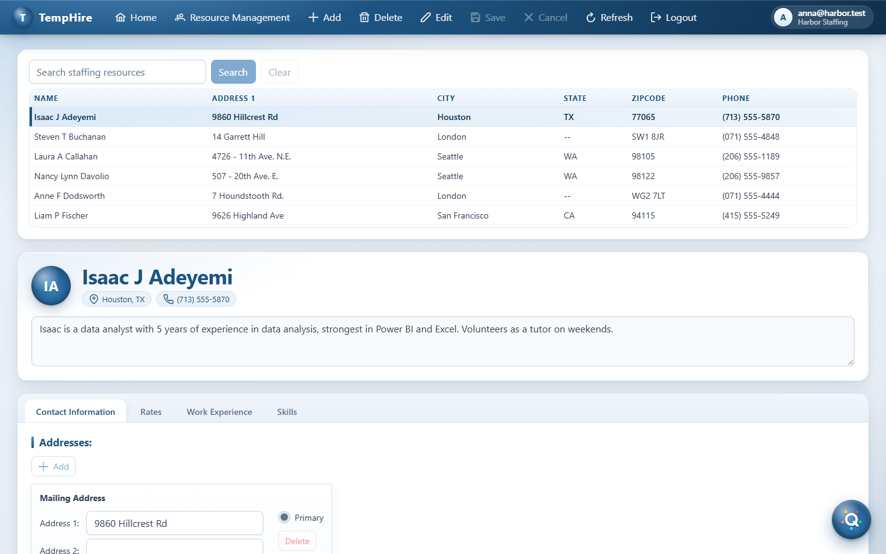
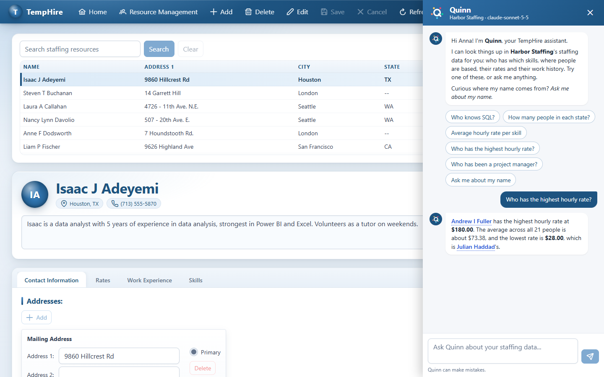
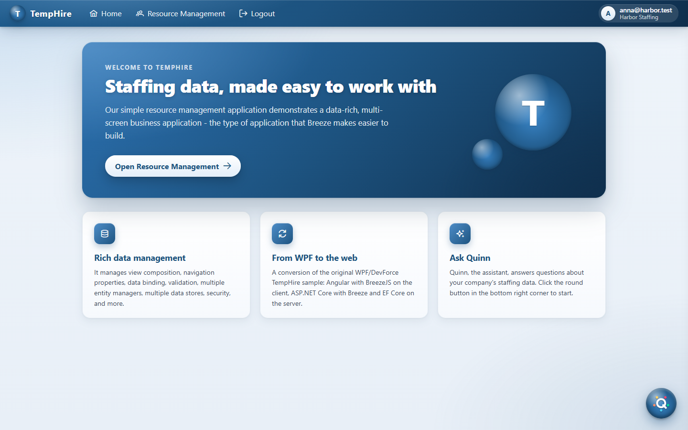
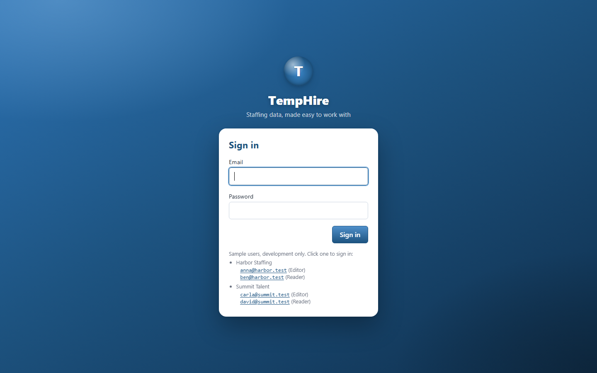

# TempHire (Angular + BreezeJS + .NET)

TempHire is a **reference implementation of a data-driven line-of-business application** on a
modern stack: **Angular** on the client, **Breeze** for data access - entity caching, change
tracking, validation and save - and the latest **.NET** with **EF Core** on the server.  It covers
what such applications need beyond CRUD screens: a master/detail workspace, editing in isolated
sandboxes with save and cancel, a cached lookup data set, client- and server-side validation from
one model, authentication, and entity classes generated from the server's model.

> **Prefer React?** [temphire.react](https://github.com/Breeze/temphire.react) is the same
> application converted to **React 19**, with Mantine, React Router and Vite, on the same Breeze 3
> and .NET server.  Every file names its Angular counterpart here, and a
> [guide to React for Angular developers](https://github.com/Breeze/temphire.react/blob/main/docs/REACT-FOR-ANGULAR-DEVELOPERS.md)
> maps the concepts side by side, with examples from both versions.



**Contents**

- [Screenshots](#screenshots)
- [Prerequisites](#prerequisites)
- [Running it](#running-it)
  - [Building for production](#building-for-production)
- [Entity classes are generated](#entity-classes-are-generated)
- [Quinn, the assistant](#quinn-the-assistant)
  - [Budgets and the usage page](#budgets-and-the-usage-page)
- [Signing in](#signing-in)
- [The server](#the-server)
- [Layout](#layout)
- [Why these libraries](#why-these-libraries)
  - [Angular as of version 22](#angular-as-of-version-22)
  - [Validation comes from the server](#validation-comes-from-the-server)
- [Configuration](#configuration)
- [Known gaps](#known-gaps)

> **Built on Breeze 3.** TempHire uses [**Breeze 3**](https://github.com/Breeze/breeze-client-v3),
> the new major version of Breeze released in September 2026: `breeze-client` 3 on the client, an
> ESM-only rewrite for modern TypeScript with typed entities, typed queries and an entity class
> generator, and the matching Breeze .NET server 8 from
> [breeze-server-v3](https://github.com/Breeze/breeze-server-v3).  The app shows those features in
> use: generated entity classes (see [Entity classes are generated](#entity-classes-are-generated)),
> typed queries and `createEntity` calls, and validation driven by the server's model (see
> [Validation comes from the server](#validation-comes-from-the-server)).

It goes beyond the original in two ways.  It is **multi-tenant**: each user belongs to a company,
and every query and save is confined to that company's data (see
[Multi-tenancy](https://github.com/Breeze/temphire.server#multi-tenancy)).  And it has **Quinn**,
an AI assistant in a chat pane who answers questions about the company's staffing data in plain
language, through an MCP server in the same .NET server, with a local Ollama model or Claude (see
[Quinn, the assistant](#quinn-the-assistant)).

It is also a **modernization example**.  TempHire began as a .NET **Silverlight** and **WPF**
application built on IdeaBlade's **Punch** framework, which combines DevForce, Caliburn.Micro and
Entity Framework.  (Punch was first called Cocktail, and its code still uses that name: the
original sample's `using Cocktail;` is Punch.)  It was converted to this
web stack, and then brought up to current Angular, Breeze and .NET, with the help of AI.  The
original Silverlight and WPF versions are in the
[Punch repository](https://github.com/IdeaBlade/Punch/tree/master/Samples/TempHire)
(`TempHire.Silverlight.sln` and `TempHire.Wpf.sln`), so the two can be read side by side: every
ported file names the file it came from, and `docs/CONVERSION-NOTES.md` maps the old architecture
onto the new one.  [**The modernization story**](docs/MODERNIZATION.md) tells the whole journey:
the conversion to a modern stack, and then what was built on it - Quinn, multi-tenancy, a fresh UI,
OAuth 2.1, validation rules in one file, a React client, and a documented API with bounded
queries.

Have a Silverlight, WPF or DevForce application of your own to take forward?  That is what
[IdeaBlade](https://www.ideablade.com/modernization/), the team behind Breeze and DevForce, does.

| | Original (Silverlight / WPF) | This version |
|---|---|---|
| Client | Silverlight or WPF + Punch (Caliburn.Micro) | **Angular 22** (standalone, zoneless, signals) + **Optimus UI 2** |
| Data access (client) | DevForce `EntityManager` | **[breeze-client 3](https://github.com/Breeze/breeze-client-v3)** |
| Server | DevForce EntityServer (WCF) | **ASP.NET Core 10** + **Breeze.AspNetCore 8** |
| ORM | Entity Framework 6 (Code First) | **EF Core 10** |
| Database | SQL Server Compact (`.sdf`) | **SQL Server LocalDB / Express** |
| Auth | DevForce `IEntityLoginManager` + server session | **ASP.NET Core Identity** + **OAuth 2.1** ([OpenIddict](https://documentation.openiddict.com/)) |

The application behaves the same as the original: log in, search staffing resources, view one,
edit it in an isolated sandbox, and save or cancel. `docs/CONVERSION-NOTES.md` maps every piece of
the old architecture onto its replacement and records the places where behaviour deliberately
changed. The conversion was made from the WPF version, so where the two originals differ, the
table and the notes describe WPF.

The server is shared with the React version: it is
[temphire.server](https://github.com/Breeze/temphire.server), included here as a git submodule in
`server/` (see [The server](#the-server)).

---

## Screenshots

**Quinn**, the assistant, answers in plain language and links the people it mentions to their
records:



**Home**, the default workspace:



**Sign in**, on the server's own sign-in page (see [Signing in](#signing-in)); in
development it lists the sample users, and a click on one signs in:



The look - cards with layered shadows on a soft gradient, in one blue - comes from
`client/src/styles.css` and the theme preset in `client/src/app/core/theme/temphire-preset.ts`.

---

## Prerequisites

- [.NET SDK](https://dotnet.microsoft.com/download) — the 10.0 SDK or later
- [Node.js](https://nodejs.org) **26.13.0**, the version pinned in `.node-version` (with npm 11.20.0).
  With [nvs](https://github.com/jasongin/nvs), `nvs auto` (or `nvs auto on`) selects it, and adds
  it if it is missing, in any directory of the repository; fnm reads the file as well.  The
  Angular 22 CLI itself accepts 22.22.3+, 24.15+ or 26+.
- SQL Server **LocalDB**, or any SQL Server instance, and for Quinn, Ollama or an Anthropic API key:
  see the server's [prerequisites](https://github.com/Breeze/temphire.server#prerequisites).

## Running it

The server is a git submodule, so clone with `--recurse-submodules`:

```
git clone --recurse-submodules https://github.com/Breeze/temphire.angular.git
```

In a clone made without it, run `git submodule update --init` once.  After a `git pull` that moves
the submodule to another commit, run `git submodule update` to check that commit out.

Then two terminals. Server first, because the client fetches its Breeze and validation metadata
from it.

**1. Server** (`http://localhost:5000`)

```
cd server/TempHire.Server
dotnet run
```

On startup the server creates or migrates its two databases (`TempHire` and `TempHireIdentity`)
and seeds them with two companies, their users and their staffing resources; see the server's
[Running it](https://github.com/Breeze/temphire.server#running-it).  It also describes its API with
Swagger UI, at `http://localhost:5000/swagger`, where its root redirects; sign in with
**Authorize** (see the server's [Swagger](https://github.com/Breeze/temphire.server#swagger)).

**2. Client** (`http://localhost:4200`)

```
cd client
npm install
npm start
```

Then open <http://localhost:4200> and sign in as one of the
[sample users](https://github.com/Breeze/temphire.server#sample-users), such as
`anna@harbor.test` (an Editor at Harbor Staffing) or `ben@harbor.test` (a Reader there).  The
password is **`password`** for all of them.

The app sends you to the server's sign-in page.  When the server runs in the Development
environment, the page lists the sample users too, and a click on one signs in as that user;
anywhere else it doesn't offer them.

Sign in as one user from each company to see that each sees only their own company's people, and
that Quinn only knows about them too.

### Building for production

```
cd client
npm run build:server     # builds into ../server/TempHire.Server/wwwroot
cd ../server/TempHire.Server
dotnet run --environment Production
```

`Program.cs` already serves static files and falls back to `index.html`, so the whole app is then
available from the server's own origin and no CORS is involved.

---

## Entity classes are generated

The TypeScript entity classes in `client/src/app/core/model/` are written by the entity generator
that ships with `breeze-client` 3 (`breeze-gen-entities`), from the same Breeze metadata the server
publishes. The flow has three steps, and `npm run model` in `client/` runs the first two:

```
EF Core model ──► client/metadata.json ──► client/src/app/core/model/*.ts ──► registerModelClasses
   (server)      npm run model:metadata     npm run model:generate           (at login, client)
```

1. **Export the metadata.** `npm run model:metadata` runs the server with `--export-metadata`, which
   writes exactly what `GET /api/model/Metadata` serves to `client/metadata.json` and exits. It
   reads the EF Core model only, so it needs no database and no login. The file is checked in, so a
   schema change shows up in review as a metadata diff next to the class diff it causes.
2. **Generate the classes.** `npm run model:generate` writes one class per entity type, each
   extending the hand-written `BaseEntity`, plus an `index.ts` barrel with `registerModelClasses`.
   Generated lines end in `// @generated`; constructors, getters and methods you add (such as
   `StaffingResource.addAddress`) are never touched, so regenerating is always safe.
3. **Register them.** `core/model-registration.ts` calls `registerModelClasses` on the master
   manager's `MetadataStore` once the metadata has loaded. From then on Breeze builds entities from
   these classes, and the typed APIs work: `EntityQuery.from(StaffingResource)` is an
   `EntityQuery<StaffingResource>`, and `createEntity(Address, { ... })` checks its initial values
   against the class.

**After changing an entity on the server**, run `npm run model` in `client/` and commit the
metadata and class changes together. `client/src/app/core/model/README.md` covers the markers for
keeping a hand-written property away from the generator.

---

## Quinn, the assistant

Once you are signed in, a round button in the bottom right corner opens a chat pane with **Quinn**,
who answers questions about your company's staffing data: *Who knows SQL?*, *How many people do we
have in each state?*, *Who has worked as a project manager?*  The first time the pane opens, Quinn
introduces themselves and offers example questions to click.  Answers are Markdown, rendered in the
pane, so figures arrive as lists and tables.  The people Quinn mentions are links: a click closes
the pane and opens that person in Resource Management, searched for by last name and selected.

Ask Quinn about their name, and they tell you where it comes from: *Punch*, the drink, is named
after the Hindi *panch*, five, for its five ingredients, and TempHire began on IdeaBlade's Punch
framework.  *Quinn* comes from the Latin *quinque*, five as well.

On the client (`client/src/app/quinn/`):

- **The pane only shows the conversation.**  It sends the conversation so far to
  `POST /api/agent/chat` and appends the answer; the server keeps no chat state.  Quinn exists only
  while someone is signed in, so signing out discards the conversation.
- **Answers stream.**  The server answers with newline-delimited JSON; the client reads the pieces
  from `HttpClient`'s download progress events, so the request still goes through the usual
  interceptors.  While tools run, nothing streams and the pane shows its typing indicator.
- **Links to people.**  With the answer, the server names the people the tools returned, with their
  ids.  The client's `linkPeople` turns those names in the answer into links to
  `/resourcemgt?resource=<id>` as the answer is shown, even while it streams.  The people from
  earlier answers in the conversation count too, so a follow-up such as "What other skills do they
  have?", which names people without looking them up again, is linked as well.  The pane catches
  clicks on links into the app and routes them; `ResourceMgtComponent` receives the id as its
  `resource` input (the router binds query parameters to inputs), opens the person, with the usual
  prompt if there are unsaved edits, and searches for them.

### Budgets and the usage page

Quinn's answers from a paid model cost money, so the server gives each user and each company a
**budget in dollars** per day, week and month, for each model: as shipped, $0.50 a day per user and
$10 a month per company for Claude, about 38 and 770 questions; Ollama is free and unlimited.  The
server explains the budgets, what they buy and how to change them in
[Budgets: usage and quotas](https://github.com/Breeze/temphire.server#budgets-usage-and-quotas).

- **The user menu.**  The signed-in user in the top right corner opens a menu with **Usage** and
  **Logout**.
- **The usage page** (`client/src/app/usage/`, route `/usage`) shows, per model, what Quinn's
  answers cost the user and their company today, this week and this month, against the budgets,
  with the tokens they took: the model Quinn uses now first.  The bars turn amber at 80% and red when
  a budget is used up; an unlimited model shows its tokens without bars.  The page reads
  `GET /api/usage` when it opens and on Refresh.
- **Quinn's pane** reads the same usage when it opens and after every answer.  While a budget of the
  model Quinn uses is used up, it says which one and how long until it starts over, counting down,
  and disables the question box, Send and the example questions until midnight UTC brings the budget
  back.  The server refuses such a question anyway (429); the pane only says so before the user
  asks.  A budget can be overrun slightly: the question that crosses it is answered in full.

The server's README explains the rest:
[how Quinn works](https://github.com/Breeze/temphire.server#how-it-works),
[Ollama or Claude](https://github.com/Breeze/temphire.server#ollama-or-claude),
[setting up Ollama](https://github.com/Breeze/temphire.server#setting-up-ollama),
[setting up Claude](https://github.com/Breeze/temphire.server#setting-up-claude) and
[budgets](https://github.com/Breeze/temphire.server#budgets-usage-and-quotas).

---

## Signing in

The server is its own OAuth 2.1 authorization server, and the app signs in with the Authorization
Code flow and PKCE (see [Users and sign-in](https://github.com/Breeze/temphire.server#users-and-sign-in)
in the server's README).  On the client:

- **Signing in.**  `AuthService.signIn` sends the browser to the server's `connect/authorize`,
  which shows the sign-in page if needed and returns a code to the app's `/auth/callback`
  (`auth-callback/`).  The app redeems it at `connect/token` with the PKCE verifier, which never
  left the browser tab.
- **Staying signed in.**  `AuthService.accessToken()` renews the access token shortly before it
  expires with the refresh token, and `auth.interceptor.ts` attaches it to the server's requests.
  The tokens are kept in session storage, so each tab signs in on its own, but the server's cookie
  makes that a quick round trip without the sign-in page.
- **Signing out** forgets the tokens and goes through `connect/logout`, which returns to the app,
  and so to the sign-in page.
- **Roles.**  `AuthService` gets the user's roles from `api/account/me` after signing in or
  reloading.  `roleGuard` keeps the Resource Management route to editors and readers, sending
  anyone else to Home with a message, and the toolbar lists only the workspaces the user may open.
  A reader's Resource Management toolbar has only Refresh: Add, Delete, Edit, Save and Cancel are
  left out.  None of this is security; it only keeps the client from offering what the server
  refuses (see [Roles](https://github.com/Breeze/temphire.server#roles)).

---

## The server

The server is **ASP.NET Core 10** with the **Breeze .NET server 8** and **EF Core 10** on SQL
Server, shared with the React version.  It lives in its own repository,
[temphire.server](https://github.com/Breeze/temphire.server), included here as a git submodule in
`server/`, and its README documents it.  In short, it:

- serves the Breeze metadata, queries and saves, and the validation metadata, and checks every
  save against the same rules as the client, on the database as it will be after the save;
- confines each user to their company's data, the company taken from their email domain;
- signs users in as its own OAuth 2.1 authorization server, with ASP.NET Core Identity and
  OpenIddict, and enforces the Editor and Reader roles;
- runs Quinn, with an MCP server that other MCP clients such as Claude Code can use as well;
- creates, migrates and seeds its databases on startup.

The sections of its README:

- [Running it](https://github.com/Breeze/temphire.server#running-it), with the
  [sample users](https://github.com/Breeze/temphire.server#sample-users),
  [Swagger](https://github.com/Breeze/temphire.server#swagger) and the
  [tests](https://github.com/Breeze/temphire.server#tests)
- [Quinn, the assistant](https://github.com/Breeze/temphire.server#quinn-the-assistant):
  [how it works](https://github.com/Breeze/temphire.server#how-it-works),
  [Ollama or Claude](https://github.com/Breeze/temphire.server#ollama-or-claude),
  [setting up Ollama](https://github.com/Breeze/temphire.server#setting-up-ollama),
  [setting up Claude](https://github.com/Breeze/temphire.server#setting-up-claude),
  [budgets](https://github.com/Breeze/temphire.server#budgets-usage-and-quotas)
- [Multi-tenancy](https://github.com/Breeze/temphire.server#multi-tenancy):
  [query limits](https://github.com/Breeze/temphire.server#query-limits)
- [Users and sign-in](https://github.com/Breeze/temphire.server#users-and-sign-in):
  [using TempHire's MCP server from Claude Code](https://github.com/Breeze/temphire.server#using-temphires-mcp-server-from-claude-code),
  [roles](https://github.com/Breeze/temphire.server#roles),
  [adding an external provider such as Microsoft Entra ID](https://github.com/Breeze/temphire.server#adding-an-external-provider-such-as-microsoft-entra-id)
- [Validation](https://github.com/Breeze/temphire.server#validation):
  [validating the database as it will be after the save](https://github.com/Breeze/temphire.server#validating-the-database-as-it-will-be-after-the-save),
  [concurrency](https://github.com/Breeze/temphire.server#concurrency)
- [The database schema](https://github.com/Breeze/temphire.server#the-database-schema) and
  [using a different database](https://github.com/Breeze/temphire.server#using-a-different-database)
- [Configuration](https://github.com/Breeze/temphire.server#configuration),
  [layout](https://github.com/Breeze/temphire.server#layout) and
  [known gaps](https://github.com/Breeze/temphire.server#known-gaps)

**Changing the server.**  `server/` is a clone of temphire.server: commit and push there, then
commit the submodule's new commit here, so this repository records which server version it runs
with.

---

## Layout

```
temphire.angular/
├── server/                        # git submodule: temphire.server (see its README's Layout)
│   ├── TempHire.sln
│   ├── TempHire.Model/            # entities, DbContexts, migrations, sample data
│   ├── TempHire.Server/           # Breeze, validation, OAuth, Quinn and MCP
│   └── TempHire.Server.Tests/     # saves, rules, sample data, queries, who may call what
├── temphire.ivproj                # IdeaBlade Validation Editor project (see Editing the rules)
└── client/
    ├── metadata.json              # Breeze metadata exported from the server (npm run model:metadata)
    └── src/app/
        ├── core/
        │   ├── model/             # generated entity classes + hand-written methods (npm run model)
        │   ├── model-registration.ts   # registers the classes and adds client-only validators
        │   ├── model-display-names.ts  # friendly property names for validation messages
        │   ├── projections/       # non-entity query results (StaffingResourceListItem)
        │   ├── services/          # ← Punch: EntityManagerProvider, UnitOfWork,
        │   │                      #   Repository, UnitOfWorkManager<T>, toolbar, dialogs, auth
        │   └── dialogs/
        ├── auth-callback/         # where the sign-in page returns to (code → tokens)
        ├── home/                  # ← ViewModels/HomeViewModel.cs
        ├── resource-mgt/          # ← ViewModels/StaffingResource/
        │   └── sections/          # the four detail tabs
        ├── quinn/                 # Quinn's launcher button and chat pane
        ├── usage/                 # Quinn's usage and budgets, from the user menu
        ├── app.ts / app.html      # ← Views/ShellView.Wpf.xaml
        └── app.routes.ts          # ← Punch workspaces + INavigator
```

Every ported file carries a doc comment naming the WPF file it came from, so you can read the two
side by side.

---

## Why these libraries

**[Optimus UI](https://optimus.openng.org/)** for the UI. TempHire is a data-dense desktop-style
app: its screens are grids, tabs, modal dialogs and inline editors. Optimus UI's `p-table`,
`p-tabs`, `DynamicDialog`, `p-select`, `p-inputNumber` and `p-datePicker` map almost one-to-one
onto the WPF `DataGrid`, `TabControl`, Punch dialogs, `ComboBox` and Xceed editors, which keeps
the conversion honest. Angular Material would also work but its table is lower-level, so the
address/phone/rates/skills grids would need noticeably more hand-written code.

Optimus UI is the MIT-licensed, community-maintained fork of PrimeNG 21; PrimeNG itself went
closed source with a commercial license, and from version 22 shows a license notice in the
corner of any app without a key. A sample app should not need a commercial license, so TempHire
uses the fork. Its API is PrimeNG's: components keep their `p-` selectors and icons their `pi-`
classes, and only the package names (`@openng/optimus-ui/...` for `primeng/...`) and a few
identifiers (`provideOptimus` for `providePrimeNG`) differ. Optimus UI 2 targets Angular 22.

The rest of the WPF-era dependencies did not need replacing so much as *deleting*:

| Original | Replacement | Why |
|---|---|---|
| Caliburn.Micro (MVVM, conventions, `IEventAggregator`) | Angular components and signals | Angular already is an MVVM framework.  The event aggregator stays (`EventAggregator`), its messages become signals (`lastSave`, `lastLogout`) that whoever cares reads; a unit of work's own changes are a signal on it (`UnitOfWork.changes`) |
| Punch (`IUnitOfWorkManager`, `IRepository`, `IFactory`, `IDialogManager`, `IBusyWatcher`, `INavigator`) | Hand-ported into `core/services` | These are ~250 lines of pattern, and porting them keeps the app's architecture recognisable. Navigation becomes the Angular router |
| MEF (`[Export]`, `[ImportMany]`) | Angular DI + explicit lists | Angular DI covers the singleton/scoped cases; the two places MEF was used for *discovery* (workspaces, detail sections) are now explicit lists, called out in the code |
| Xceed WPF Toolkit `BusyIndicator` | `BusyService` + `p-progressSpinner` | |
| `System.Windows.Interactivity` behaviours | Native DOM behaviour / directives | `SelectAllOnFocusBehavior`, `InitialFocusBehavior` etc. are one-liners in HTML |
| `IdeaBlade.Validation` | Breeze validators, derived from the EF Core model | `[Required]`/`[StringLength]` on the server entities reach the client automatically in the Breeze metadata |

No date, HTTP or utility library was added: Angular's `HttpClient` and the platform's `Intl` cover
what jQuery/lodash/moment would once have been used for.

### Angular as of version 22

The client is meant to show current Angular, not just to run on it:

- **Standalone components, no NgModules**, lazy-loaded routes, functional guards and interceptors.
- **Zoneless and OnPush.** There is no zone.js, and Angular 22 makes OnPush the default change
  detection for every component.  Views update from signals, so state lives in signals.
- **Signals throughout.** `input()` / `output()` instead of decorators, `computed` for derived
  state, `linkedSignal` where a value must survive a reload (the search grid keeps its rows while
  new ones load), and `effect` only for genuine side effects.
- **Breeze entities and signals.** Entities are plain mutable objects, so a unit of work turns its
  `EntityManager`'s change events into a counter signal, `UnitOfWork.changes`, plus a `hasChanges`
  signal.  The toolbar's Save and Cancel derive from those, so an edit anywhere in a sandbox
  enables Save without any subscription.
- **`resource()`** loads the search results; its params are the search text and the latest save
  (`EventAggregator.lastSave`), so a save anywhere reloads the list.
- **Signal Forms** (`@angular/forms/signals`) for the forms over plain data: login, the search box
  and the name editor.  The entity editors keep `[(ngModel)]` bound straight to the Breeze
  entities, as Breeze recommends: a Signal Form would hold a second copy of every value, kept in
  step with the entity by hand.  Either way, validation comes from Breeze; see below.
- **`@defer`** for the Rates, Work Experience and Skills tabs, each loaded as its own chunk when its
  tab is first opened.
- **Injection functions** such as `registerToolbarGroup`, which adds a toolbar group and removes
  it through `DestroyRef`, in place of lifecycle hooks.
- **The `@angular/build` builder** (esbuild, a Vite dev server, Vitest for `ng test`); there is no
  Webpack.
- **No deprecated APIs.** New keys come from `crypto.randomUUID()` rather than Breeze's
  deprecated `core.getUuid()`.  `crypto.randomUUID()` needs a secure context, which `localhost` and
  any HTTPS deployment are; serving the app over plain HTTP from another host would need a
  fallback.

### Validation comes from the server

> Validation uses IdeaBlade Validation 0.1.0: [`ideablade-validation`](https://www.npmjs.com/package/ideablade-validation)
> on npm and [`IdeaBlade.Validation`](https://www.nuget.org/packages/IdeaBlade.Validation) on NuGet.
> As with any 0.x version, its API may still change between minor versions.

The validation rules are written once, on the server, in two places:

- **the entities' data annotations** - `[Required]`, `[StringLength]` - which reach the client in
  the Breeze metadata as validators;
- **the validation metadata**, `server/TempHire.Server/Validation/validation.metadata.json`, for
  the rules annotations cannot express: an address is a U.S. address, with a state and a ZIP code;
  a phone number is a U.S. number in one field, in any of the common formats (10 digits; dashes,
  dots or spaces between its parts; the area code in parentheses; a leading 1 or +1), rewritten as
  `(206) 555-1234` when the user leaves the field; a rate is a valid amount and not negative; dates are valid dates; a date of birth is
  neither in the future nor more than 123 years ago; and a staffing resource has at least one
  address and one phone number, and it is at least 18 years old when hired.  These use
  [IdeaBlade.Validation / `ideablade-validation`](https://github.com/Breeze/ideablade-validation),
  which reads the same metadata on both sides.

The metadata's global `breeze` validator brings in the annotations: on the client it runs Breeze's
validators, which Breeze builds from them, and on the server the annotations themselves.  So every
rule, annotation or not, surfaces as the same kind of `ValidationError`, on both sides.  The
server's README describes its side in
[Validation](https://github.com/Breeze/temphire.server#validation).

At sign-in, `EntityManagerProvider` loads the validation metadata (`api/validation/Metadata`) next to
the Breeze metadata and installs it into Breeze (`installBreezeValidators`).  From then on Breeze
runs all the rules as properties change, when an entity is attached, and before every save, so a
save that breaks a rule never leaves the client.  The server checks the same metadata again when it
saves (`TempHirePersistenceManager`), against the database as it will be after the save
(`SaveValidationStore`).  Its messages name properties as the payload does (`'StateId' is
required`, `The City field is required.`).

The forms add no rules of their own; they show the verdict:

- **Entity editors** use the library's template-driven-forms directives
  (`ValidationFormsDirectives`).  Each card or row names its entity once, with `ngForm
  [validationModel]`; a field's property is its `name`, and the model type comes from the entity
  (`breezeModelType`).  A field runs its property's rules - Breeze's own included, through
  `breeze` - on the value being typed, and its control is invalid when one fails.
  `FieldErrorsDirective` (`core/validation`) shows the errors the screen shows (below): their
  messages as the field's tooltip, `aria-invalid`, and through `invalid()`, PrimeNG's red border.

  ```html
  <div ngForm [validationModel]="address">
    <input pInputText name="city" [(ngModel)]="address.city" #city="fieldErrors" [invalid]="city.invalid()" />
  </div>
  ```

  Errors the *server* reports for a failed save are shown in the save's error message, not on
  fields; the client checks the same rules first, so they are rare.

- **A form validates the whole entity** whenever a field changes, so a rule about two fields shows
  on both: "at least 18 years old when hired" names both dates (`propertyNames` in the
  metadata), and changing either one re-checks the other.  The summary card shows its message once,
  under the dates, when the fields show it (below).
- **The route has its own validation service** (`provideValidationScope` in
  `ResourceMgtComponent`), whose entity store is the unit of work being shown.  Its forms see that
  unit of work's entities in `store(type)`, and re-validate whenever an entity in it changes, in
  another section or in code.
- **The service also validates that unit of work continuously** (`validateEntityStore()`): every
  live entity against every rule, sync and async, the metadata's and Breeze's, again whenever an
  entity changes.  The fields, the tab marks and the Save button follow that one result.  Saving
  goes through `SaveHandler` (`core/services/save-handler.ts`), which every workspace uses: it
  validates the unit of work again when Save is clicked (`validateEntityStoreOneTime`), since the
  continuous result catches up with an edit a moment later and a Save clicked right after an edit
  would otherwise miss it.  Nothing is saved while any rule is broken, async ones included: the
  handler shows every error and says why.  After every save (a deletion too), each unit-of-work
  manager drops its shared cache, on the saved event (`EventAggregator`), so the read-only views
  re-read what was saved.
- **A new resource is not all red at once.**  The screen's `ErrorVisibility`
  (`provideErrorVisibility({ isNew: breezeIsNew, watchEntityStore: true })` in
  `ResourceMgtComponent`) decides which errors to show; validation itself is unchanged.  Loaded
  entities show all their errors.  A new one - a resource, or an address or phone number added to
  one - starts with its first errors hidden: a field's show once the user edits or leaves it, and
  an error the user causes shows at once, on every field it is about, touched or not.  Save stays
  enabled while rules are broken: clicking it shows every error, and a "Not saved" message says
  why nothing happened and where to look.  An entity added after that starts with its errors hidden again.  The
  library's [Showing errors](https://github.com/Breeze/ideablade-validation/blob/main/docs/concepts.md#showing-errors-error-visibility)
  describes the rules.
- **Rules about a whole entity**, such as "at least one address", have no field.  Validating the
  whole unit of work keeps them current - deleting a resource's last address breaks the resource's
  rule without changing the resource - and the address and phone lists show them from the same
  result, through `injectErrorVisibility()`, so they follow the same rules: a new resource's
  messages show on a save attempt, or when the user deletes the last address or phone number.  A
  new resource starts without an address or a phone number, and the last one of each can be
  deleted, so the rule is the user's to satisfy.
- **Tabs with errors are marked.**  Each detail tab shows a red count of the errors it has to show,
  so a problem on a tab the user is not looking at does not have to be hunted for.  The counts come
  from the same validation of the unit of work, not from the fields - the deferred tabs have none
  until they are opened - and follow the error visibility (`injectErrorVisibility()` in
  `ResourceDetailComponent`): a new resource's tabs are marked once the user breaks a rule or tries
  to save.  `resource-tabs.ts` places each error on a tab by the type of its entity, and the
  resource's own rules by their id; its test fails for an entity type or a rule nobody has placed.
- **The name editor**, a Signal Form over names for a `StaffingResource`, validates a
  `ResourceName` view model with `validateWithMetadata`.  Its properties inherit the
  `StaffingResource` properties' Breeze rules with `from` (`core/validation/client-validation-metadata.ts`,
  through `breezeRuleSource`), so nothing is restated.  Signal Forms then hand the result to Optimus
  UI themselves.  The dialog shows a name's errors once its field has been touched (Signal Forms'
  own `touched()`), not through the screen's `ErrorVisibility`, and OK waits until the names are
  valid.
- **Login** keeps Signal Forms' `required`: credentials are not an entity, so there is no model to
  validate them against.

**Display names live in one place.**  Breeze names a property in its messages by its `displayName` -
`'%displayName%' is required` - and the Breeze .NET server does not send display names; the
validation metadata has none either.  So once the metadata has loaded, `setDisplayNames`
(`core/model-display-names.ts`) gives every Breeze property one: derived from the property name
(`positionTitle` is "Position title", `stateId` is "State"), or taken from a short table of overrides
that match the labels on screen (`number` is "Phone number").  The table is keyed by the generated
classes, so a misspelt or removed property is a compile error.  `displayNameMetadata` then hands
Breeze's display names to the validation metadata, so its messages use them too: `'State' is required`
reads like `'City' is required`, in the entity editors and in the name editor alike.

#### On the server: validating the database as it will be after the save

The server checks every save against the same metadata, and not only against what the save holds:
it loads the related entities the rules read, applies the save on top, and validates **the
database as it will be after the save**.  So a rule that two users break together - each deleting
a different one of a resource's two addresses - is caught even though neither save was wrong on its
own, and no concurrency check would catch it.  The code that loads those entities is TempHire's
own, written from its model, and an AI coding assistant can keep it in step with the rules.  The
server's README explains it in
[Validating the database as it will be after the save](https://github.com/Breeze/temphire.server#validating-the-database-as-it-will-be-after-the-save).

#### Concurrency

Every entity the client can save has a `RowVersion`, and a save that would overwrite or delete a
row someone else saved in the meantime fails with a concurrency conflict (409); see
[Concurrency](https://github.com/Breeze/temphire.server#concurrency) in the server's README.  The
client tells the user so, in plain words, rather than showing the database's message: someone else
changed this data, so click Refresh to load the latest, then make the changes again and save
(`CONCURRENCY_CONFLICT` in `error-handler.service.ts`).

#### Editing the rules

The rules can be edited by hand, or in the
[IdeaBlade Validation Editor](https://github.com/Breeze/ideablade-validation-editor), a desktop app
that writes the metadata through forms and checks it with the library as you type.  Open
`temphire.ivproj` at the root of this repo in it: that opens both metadata files, the server's
`validation.metadata.json` and the client's `client-validation-metadata.ts`, and loads what the
forms and the code completion in expressions offer: the entities from `client/metadata.json`
(regenerated with `npm run model`), the list projection in `core/projections/`, and the name
editor's `ResourceName`.  A new file in `core/projections/` is picked up as soon as it's written.

---

## Configuration

| Setting | Where | Notes |
|---|---|---|
| `modelApiRoot` / `lookupsApiRoot` / `resourceMgtApiRoot` / `validationApiRoot` / `accountApiRoot` / `agentApiRoot` / `usageApiRoot` / `authority` | `client/src/environments/` | `environment.ts` is the **production** file; `environment.development.ts` replaces it during `ng serve` |

The server's settings - connection strings, signing keys, allowed client origins, Quinn's model -
are in [its README](https://github.com/Breeze/temphire.server#configuration).

---

## Known gaps

- **No end-to-end tests.** The original had no tests at all; the conversion has unit tests on both
  tiers, over 100 in the client (`ng test`, Vitest) and over 60 on the server (`dotnet test` in
  `server/`).  The client's cover:
  - the services: the sign-in guard and token handling, the dialogs, the global
    error handler, the save handler and the staffing resource repository;
  - validation: the server's rules as the client runs them, the field bindings and display names;
  - Resource Management: the search box, the grid's selection, the summary, the address list, the
    tabs' error marks and the "Not saved" message;
  - Quinn's links to people, and the usage page.

  The server's are listed in [its README](https://github.com/Breeze/temphire.server#tests).  The
  screens themselves were checked by hand in a browser.

The server's own known gaps are in [its README](https://github.com/Breeze/temphire.server#known-gaps).

See `docs/CONVERSION-NOTES.md` for the full architecture mapping and the list of deliberate
behavioural changes.
