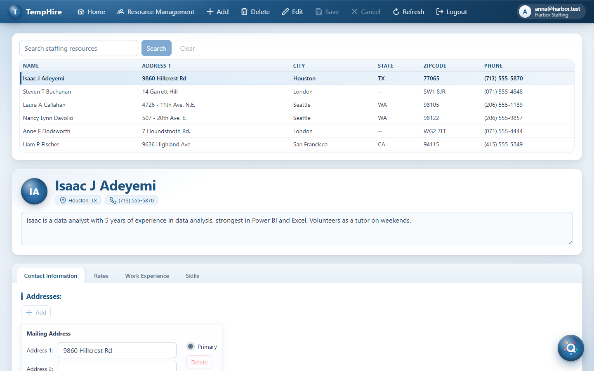
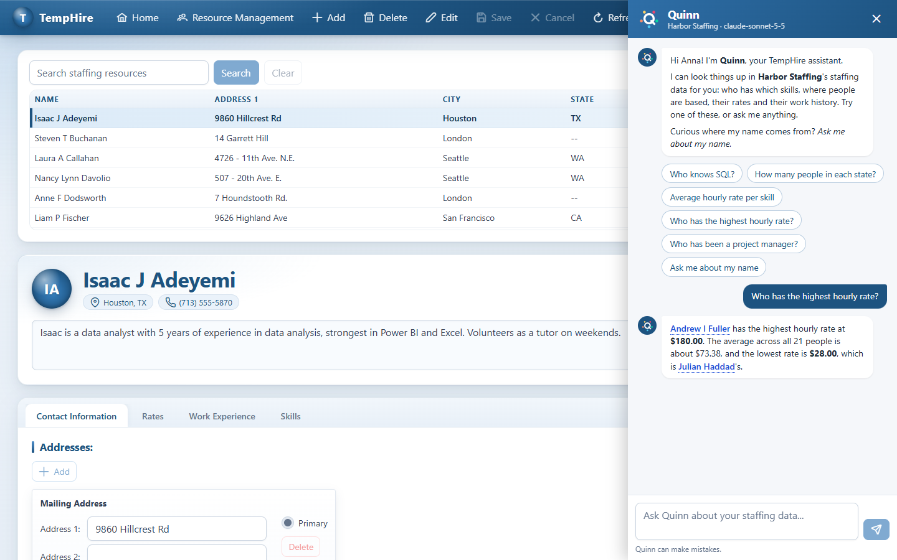
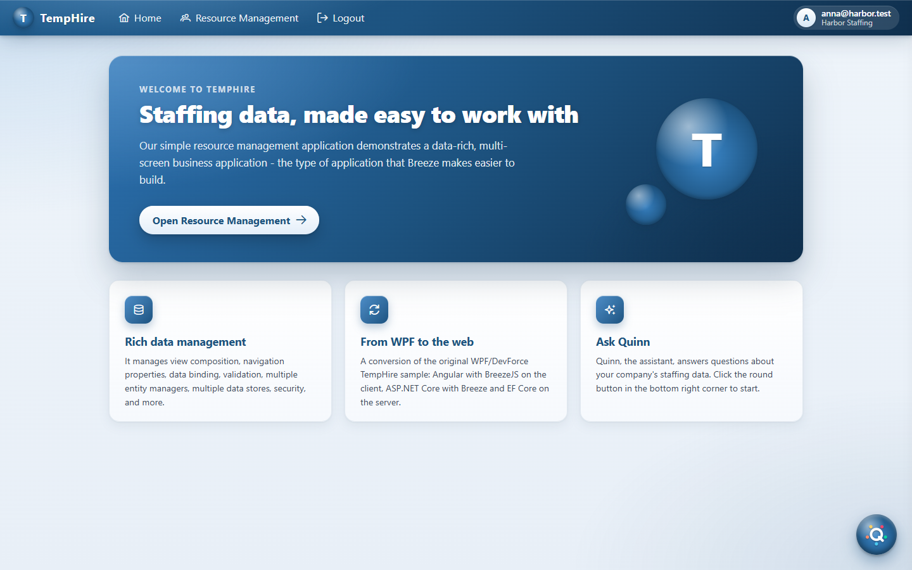
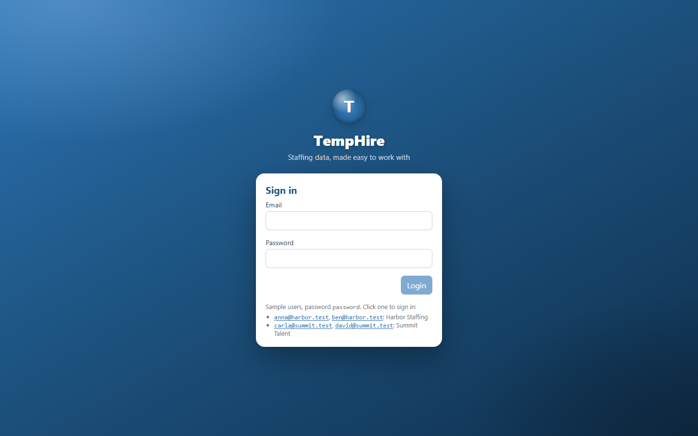

# TempHire (Angular + BreezeJS + .NET)

TempHire is a **reference implementation of a data-driven line-of-business application** on a
modern stack: **Angular** on the client, **Breeze** for data access - entity caching, change
tracking, validation and save - and the latest **.NET** with **EF Core** on the server.  It covers
what such applications need beyond CRUD screens: a master/detail workspace, editing in isolated
sandboxes with save and cancel, a cached lookup data set, client- and server-side validation from
one model, authentication, and entity classes generated from the server's model.



**Contents**

- [Screenshots](#screenshots)
- [Prerequisites](#prerequisites)
- [Running it](#running-it)
  - [Building for production](#building-for-production)
- [Entity classes are generated](#entity-classes-are-generated)
- [Quinn, the assistant](#quinn-the-assistant)
  - [How it works](#how-it-works)
  - [Ollama or Claude](#ollama-or-claude)
  - [Setting up Ollama](#setting-up-ollama)
  - [Setting up Claude](#setting-up-claude)
- [Multi-tenancy](#multi-tenancy)
- [The database schema](#the-database-schema)
- [Layout](#layout)
- [Why these libraries](#why-these-libraries)
  - [Angular as of version 22](#angular-as-of-version-22)
  - [Validation comes from the model](#validation-comes-from-the-model)
- [Using a different database](#using-a-different-database)
- [Configuration](#configuration)
- [Known gaps](#known-gaps)

> **Built on Breeze 3.** TempHire uses [**Breeze 3**](https://github.com/Breeze/breeze-client-v3),
> the new major version of Breeze released in September 2026: `breeze-client` 3 on the client, an
> ESM-only rewrite for modern TypeScript with typed entities, typed queries and an entity class
> generator, and the matching Breeze .NET server 8 from
> [breeze-server-v3](https://github.com/Breeze/breeze-server-v3).  The app shows those features in
> use: generated entity classes (see [Entity classes are generated](#entity-classes-are-generated)),
> typed queries and `createEntity` calls, and validation driven by the Breeze model (see
> [Validation comes from the model](#validation-comes-from-the-model)).

It goes beyond the original in two ways.  It is **multi-tenant**: each user belongs to a company,
and every query and save is confined to that company's data (see
[Multi-tenancy](#multi-tenancy)).  And it has **Quinn**, an AI assistant in a chat pane who answers
questions about the company's staffing data in plain language, through an MCP server in the same
.NET server, with a local Ollama model or Claude (see [Quinn, the assistant](#quinn-the-assistant)).

It is also a **modernization example**.  TempHire began as a .NET **Silverlight** and **WPF**
application built on IdeaBlade's **Punch** framework, which combines DevForce, Caliburn.Micro and
Entity Framework.  (Punch was first called Cocktail, and its code still uses that name: the
original sample's `using Cocktail;` is Punch.)  It was converted to this
web stack, and then brought up to current Angular, Breeze and .NET, with the help of AI.  The
original Silverlight and WPF versions are in the
[Punch repository](https://github.com/IdeaBlade/Punch/tree/master/Samples/TempHire)
(`TempHire.Silverlight.sln` and `TempHire.Wpf.sln`), so the two can be read side by side: every
ported file names the file it came from, and `docs/CONVERSION-NOTES.md` maps the old architecture
onto the new one.

| | Original (Silverlight / WPF) | This version |
|---|---|---|
| Client | Silverlight or WPF + Punch (Caliburn.Micro) | **Angular 22** (standalone, zoneless, signals) + **Optimus UI 2** |
| Data access (client) | DevForce `EntityManager` | **[breeze-client 3](https://github.com/Breeze/breeze-client-v3)** |
| Server | DevForce EntityServer (WCF) | **ASP.NET Core 10** + **Breeze.AspNetCore 8** |
| ORM | Entity Framework 6 (Code First) | **EF Core 10** |
| Database | SQL Server Compact (`.sdf`) | **SQL Server LocalDB / Express** |
| Auth | DevForce `IEntityLoginManager` + server session | **JWT bearer** + PBKDF2 password hashing |

The application behaves the same as the original: log in, search staffing resources, view one,
edit it in an isolated sandbox, and save or cancel. `docs/CONVERSION-NOTES.md` maps every piece of
the old architecture onto its replacement and records the places where behaviour deliberately
changed. The conversion was made from the WPF version, so where the two originals differ, the
table and the notes describe WPF.

> **A note on the .NET version.** The server targets **`net10.0`** (LTS, supported to November
> 2028) with the 10.0.x package set. It stays on .NET 10 rather than .NET 11 because Breeze 8
> supports .NET 8, 9 and 10, and `Breeze.Persistence.EFCore` 8 requires EF Core 10 (it pins
> `Microsoft.EntityFrameworkCore.Relational` to `[10.0.0, 11.0.0)`).

---

## Screenshots

**Quinn**, the assistant, answers in plain language and links the people it mentions to their
records:



**Home**, the default workspace:



**Sign in**; a development build lists the sample users, and a click on one signs in:



The look - cards with layered shadows on a soft gradient, in one blue - comes from
`client/src/styles.css` and the theme preset in `client/src/app/core/theme/temphire-preset.ts`.

---

## Prerequisites

- [.NET SDK](https://dotnet.microsoft.com/download) — the 10.0 SDK or later
- [Node.js](https://nodejs.org) **26.13.0**, the version pinned in `.node-version` (with npm 11.20.0).
  With [nvs](https://github.com/jasongin/nvs), `nvs auto` (or `nvs auto on`) selects it, and adds
  it if it is missing, in any directory of the repository; fnm reads the file as well.  The
  Angular 22 CLI itself accepts 22.22.3+, 24.15+ or 26+.
- SQL Server **LocalDB** (ships with the Visual Studio "Data storage and processing" workload and
  with [SQL Server Express](https://www.microsoft.com/sql-server/sql-server-downloads)), or any
  SQL Server instance — see [Using a different database](#using-a-different-database)
- For Quinn, one of: [Ollama](https://ollama.com) with the `qwen3:4b-instruct` model, the default
  (see [Setting up Ollama](#setting-up-ollama)); or an Anthropic API key for Claude (see
  [Setting up Claude](#setting-up-claude)).  The rest of
  the app works without either; Quinn then explains that the model isn't available.

## Running it

Two terminals. Server first, because the client fetches its Breeze metadata from it.

**1. Server** (`http://localhost:5000`)

```
cd server/TempHire.Server
dotnet restore
dotnet run
```

On startup the server brings two databases (`TempHire` and `TempHireSecurity`) up to date with EF
Core migrations, creating them on the first run, and seeds them: two companies, two users each, and
25 staffing resources per company.  Harbor Staffing's include the nine people the original sample
shipped with.  See [The database schema](#the-database-schema) for why migrating on startup is fine
here but not in production.

**2. Client** (`http://localhost:4200`)

```
cd client
npm install
npm start
```

Then open <http://localhost:4200> and sign in as one of the sample users.  The password is
**`password`** for all of them:

| User | Company |
|---|---|
| `anna@harbor.test`, `ben@harbor.test` | Harbor Staffing |
| `carla@summit.test`, `david@summit.test` | Summit Talent |

In a development build the login page lists them too, and a click on one signs in as that user.
They come from `environment.development.ts`; a production build doesn't offer them.

Sign in as one user from each company to see that each sees only their own company's people, and
that Quinn only knows about them too.

### Building for production

```
cd client
npm run build:server     # builds into ../server/TempHire.Server/wwwroot
cd ../server/TempHire.Server
dotnet run --environment Production
```

`Program.cs` already serves static files and falls back to `index.html`, so the whole app is then
available from the server's own origin and no CORS is involved.

---

## Entity classes are generated

The TypeScript entity classes in `client/src/app/core/model/` are written by the entity generator
that ships with `breeze-client` 3 (`breeze-gen-entities`), from the same Breeze metadata the server
publishes. The flow has three steps, and `npm run model` in `client/` runs the first two:

```
EF Core model ──► client/metadata.json ──► client/src/app/core/model/*.ts ──► registerModelClasses
   (server)      npm run model:metadata     npm run model:generate           (at login, client)
```

1. **Export the metadata.** `npm run model:metadata` runs the server with `--export-metadata`, which
   writes exactly what `GET /api/breeze/Metadata` serves to `client/metadata.json` and exits. It
   reads the EF Core model only, so it needs no database and no login. The file is checked in, so a
   schema change shows up in review as a metadata diff next to the class diff it causes.
2. **Generate the classes.** `npm run model:generate` writes one class per entity type, each
   extending the hand-written `BaseEntity`, plus an `index.ts` barrel with `registerModelClasses`.
   Generated lines end in `// @generated`; constructors, getters and methods you add (such as
   `StaffingResource.addAddress`) are never touched, so regenerating is always safe.
3. **Register them.** `core/model-registration.ts` calls `registerModelClasses` on the master
   manager's `MetadataStore` once the metadata has loaded. From then on Breeze builds entities from
   these classes, and the typed APIs work: `EntityQuery.from(StaffingResource)` is an
   `EntityQuery<StaffingResource>`, and `createEntity(Address, { ... })` checks its initial values
   against the class.

**After changing an entity on the server**, run `npm run model` in `client/` and commit the
metadata and class changes together. `client/src/app/core/model/README.md` covers the markers for
keeping a hand-written property away from the generator.

---

## Quinn, the assistant

Once you are signed in, a round button in the bottom right corner opens a chat pane with **Quinn**,
who answers questions about your company's staffing data: *Who knows SQL?*, *How many people do we
have in each state?*, *Who has worked as a project manager?*  The first time the pane opens, Quinn
introduces themselves and offers example questions to click.  Answers are Markdown, rendered in the
pane, so figures arrive as lists and tables.  The people Quinn mentions are links: a click closes
the pane and opens that person in Resource Management, searched for by last name and selected.

Ask Quinn about their name, and they tell you where it comes from: *Punch*, the drink, is named
after the Hindi *panch*, five, for its five ingredients, and TempHire began on IdeaBlade's Punch
framework.  *Quinn* comes from the Latin *quinque*, five as well.

### How it works

Everything runs in the existing .NET server, behind the same login as the rest of the app:

```
client ──POST /api/agent/chat──► AgentController ──► QuinnAgent ──► IChatClient (Ollama or Claude)
 (pane)    (JWT)                                        │                  │ tool calls
                                                        └── MCP client ────┴──► /mcp (MCP server)
                                                            (user's JWT)          StaffingTools ──► EF Core
```

- **The client** (`client/src/app/quinn/`) only shows the conversation.  It sends the conversation
  so far to `POST /api/agent/chat` and appends the answer; the server keeps no chat state.  Quinn
  exists only while someone is signed in, so signing out discards the conversation.
- **Answers stream.**  `api/agent/chat` answers with newline-delimited JSON: the text in pieces as
  the model writes it, the people the answer can mention as the tools return them (see below), and
  `done` at the end.  The client reads the pieces from `HttpClient`'s download progress events, so
  the request still goes through the usual interceptors.  While tools run, nothing streams and the
  pane shows its typing indicator.  This matters most with a local model, which writes slowly;
  Claude often thinks before answering on tool results and then delivers most of the answer at
  once.
- **The agent** (`server/TempHire.Server/Agent/`) uses
  [Microsoft.Extensions.AI](https://learn.microsoft.com/dotnet/ai/microsoft-extensions-ai):
  `ChatClientFactory` builds an `IChatClient` for the configured provider, with automatic function
  invocation, and `QuinnAgent` gives it Quinn's system prompt (`QuinnPersona`) and the MCP server's
  tools.  `AgentController` (`api/agent/info`, `api/agent/chat`) is the HTTP entry point.
- **The MCP server** (`server/TempHire.Server/Mcp/`) uses the
  [MCP C# SDK](https://github.com/modelcontextprotocol/csharp-sdk) and is mapped at `/mcp` with
  `RequireAuthorization()`.  Its tools in `StaffingTools` are read-only: search people by name,
  skill or location, one person's details, skills, rate statistics, counts by location, and work
  history.  They query with **EF Core LINQ, not SQL**, through the same `TempHireDbContext` as
  Breeze, so the tenant filter applies to them as to everything else.
- **The agent calls the MCP server as the user.**  `QuinnAgent` connects to `/mcp` over HTTP with
  the signed-in user's own bearer token, so the tools run with that user's identity and company.
  Nothing in the agent can reach another company's data, whatever the model asks for.  Any other
  MCP client with a valid TempHire token can use `/mcp` too.
- **Links to people are made by the client, from people the server names.**  The model doesn't
  write links, and neither does the server: what a link to a person looks like depends on the
  client, and another client, a mobile app say, would link differently.  The tools return each
  person's id along with their name.  `ToolResultPeople` picks those people out of the tool results
  of the answer, and the stream sends them to the client as a list of names and ids.  The tools
  return full names, middle name included, and a full name beats someone else's short form, so
  "Jane Doe" and "Jane M Doe" each keep their own id; a name that still fits two people is left
  out.  The client's `linkPeople` (in `client/src/app/quinn/`) turns those names in the answer into
  links to `/resourcemgt?resource=<id>` as the answer is shown, even while it streams, so only
  people the tools really returned are linked, and always to the right record; a name the model
  gets wrong, or invents, stays plain text.  The people from earlier answers in the conversation
  count too, so a follow-up such as "What other skills do they have?", which names people without
  looking them up again, is linked as well.  The pane catches clicks on links into the app and
  routes them; `ResourceMgtComponent` receives the id as its `resource` input (the router binds
  query parameters to inputs), opens the person, with the usual prompt if there are unsaved edits,
  and searches for them.

### Ollama or Claude

The `Agent` section of `server/TempHire.Server/appsettings.json` picks the model:

```json
"Agent": {
  "Provider": "Ollama",            // or "Claude"
  "MaxToolCalls": 8,
  "Ollama": { "Endpoint": "http://127.0.0.1:11434", "Model": "qwen3:4b-instruct" },
  "Claude": { "Model": "claude-sonnet-5-5", "MaxTokens": 4096 }
}
```

**Ollama** is the default: free, local, and nothing leaves your machine.  A 4-billion-parameter
model is a good demo but not a careful analyst; it sometimes misreads a tool's result, which is why
the pane notes that Quinn can make mistakes.  **Claude** gives noticeably better answers.

**Small local model or large hosted one: the same Quinn, different results.**  Both get the same
system prompt, the same tools and the same data; only the model differs, and that shows mostly in
how well it uses the tools.  Asked "Who has the Test skill?" (two people have it):

- **qwen3:4b-instruct on a laptop GPU with 4 GB** found them in about three of four tries.  The
  rest of the time it answered "I don't have information about a 'Test' skill" without looking, or
  called `list_skills`, which only counts people per skill, and stopped there.  Even when it got
  it right it tended to write "let me look that up" before calling a tool, and it often took two
  rounds of tools where one would do.  The system prompt's rules - call a tool first, use
  `search_staffing_resources` to find people - took it from none of three tries to most, and that
  is about as far as wording gets a model this size.  Forcing a tool call isn't possible either:
  Ollama's API has no setting for it.
- **Claude**, asked the same question, called the search tool straight away and named both people,
  with nothing like "let me look that up" in the answer.

A larger local model narrows the gap, if the machine can hold it: `qwen3:8b` needs about 5 GB of
GPU memory, so on a 4 GB card Ollama runs part of it on the processor, which is far slower.  Pick
the model in `Agent:Ollama:Model`.

### Setting up Ollama

1. **Install Ollama** from <https://ollama.com/download>: the installer on Windows and macOS, or
   `curl -fsSL https://ollama.com/install.sh | sh` on Linux.  It runs in the background and serves
   its API at `http://127.0.0.1:11434`, the endpoint in `appsettings.json`.
2. **Download the model** (about 2.5 GB):

   ```
   ollama pull qwen3:4b-instruct
   ```

3. **Check it** - the model is listed, and answers:

   ```
   ollama list
   ollama run qwen3:4b-instruct "Say hello"
   ```

4. **Start the TempHire server** (or restart it) and open Quinn's pane.  Its header shows
   *qwen3:4b-instruct via Ollama*.  If Ollama isn't running, Quinn replies that it can't reach
   Ollama, with the endpoint and the `ollama pull` command to check.

The first question after Ollama starts takes longer while the model loads into memory; Ollama
unloads it again after a few idle minutes.

**Another model.**  Quinn needs a model that supports tool calling: in the
[Ollama library](https://ollama.com/library) those are tagged *tools*.  Pull it and set
`Agent:Ollama:Model` to its name.  A larger model answers more reliably, if your machine has the
memory for it.  To use Ollama on another machine, set `Agent:Ollama:Endpoint` to its address.

### Setting up Claude

Claude needs an Anthropic API key (from the [Claude Console](https://platform.claude.com)), which
belongs in the server's [user secrets](https://learn.microsoft.com/aspnet/core/security/app-secrets),
never in `appsettings.json`.  `server/Set-ClaudeApiKey.ps1` prompts for it and stores it there
without echoing it.  Run it from **PowerShell**, in the `server` folder:

```powershell
.\Set-ClaudeApiKey.ps1 -UseClaude   # prompts for the key, stores it, and switches Quinn to Claude
.\Set-ClaudeApiKey.ps1 -UseOllama   # back to Ollama; the key stays stored
.\Set-ClaudeApiKey.ps1 -Remove      # deletes the key
```

From Command Prompt, `.\Set-ClaudeApiKey.ps1` opens the script in Notepad instead of running it;
run it through PowerShell there:

```
powershell -ExecutionPolicy Bypass -File .\Set-ClaudeApiKey.ps1 -UseClaude
```

(`-ExecutionPolicy Bypass` also helps in PowerShell if it reports that running scripts is disabled.)

`-UseClaude` and `-UseOllama` set `Agent:Provider` in user secrets, which overrides
`appsettings.json` on your machine only.  Restart the server after either; Quinn's header then
shows the model in use.  User secrets are read in the Development environment; in production, set
`Agent__Claude__ApiKey` from your secret store.

---

## Multi-tenancy

Each user belongs to a company, a **tenant**, and sees and changes only that company's data.

- **Tenants come from the email domain.**  The `Tenants` table maps an email domain to a tenant:
  `harbor.test` is Harbor Staffing, `summit.test` is Summit Talent.  At login,
  `AccountController` looks up the tenant for the domain of the user name and refuses users whose
  domain has none.  The tenant's id is a **GUID**, not the domain, and it travels in the JWT as the
  `tenant_id` claim, so later requests need no lookup.  `HttpCurrentTenant` reads it back as
  `ICurrentTenant`.
- **Every query is filtered.**  Every entity that belongs to a tenant implements `ITenantOwned`
  (through `AuditEntityBase`), and `TempHireDbContext` gives each of them an EF Core **global query
  filter**, `e.TenantId == CurrentTenantId`.  Breeze queries, the search projection and Quinn's
  tools all go through it; none of them mentions the tenant.  Lookup tables (states, address and
  phone types, rate types) are shared.
- **Every save is checked.**  `SaveChanges` stamps new entities with the current tenant, and
  rejects a change to, or deletion of, a row that belongs to another tenant (`403 Forbidden`).
  The filter alone would not stop that: a Breeze save names rows by key, without querying them.
- **The client never sees the tenant.**  `TenantId` is a server-only column: it is left out of the
  JSON and of the Breeze metadata (`TempHirePersistenceManager.BuildJsonMetadata`), so it is not in
  the generated entity classes either.

---

## The database schema

The schema is managed with **EF Core migrations**, in `server/TempHire.Model/Migrations/`
(`TempHire/` and `Security/`, one set per database).  On startup, `DatabaseSetup.Prepare` applies
any pending migrations to both databases and then seeds them.  A database created by an earlier
version of this sample with `EnsureCreated()` has no migration history; it is **dropped and
re-created**, losing its data.

> **This is not how a production application does it.**  Migrating on startup means every instance
> of the server races to change the schema, the application's database account needs the rights to
> alter it, and a bad migration takes the site down with it.  A real deployment applies migrations
> as a separate, reviewed step: a [migration bundle](https://learn.microsoft.com/ef/core/managing-schemas/migrations/applying#bundles)
> or an idempotent SQL script run by the release pipeline.  And it never drops a database it cannot
> migrate.  For a sample whose data is all seed data, both are fine.

**After changing an entity**, add a migration.  `dotnet-ef` is a local tool of the repository
(`dotnet-tools.json`), with the same version as the EF Core packages:

```
cd server
dotnet tool restore
dotnet ef migrations add <Name> --context TempHireDbContext --project TempHire.Model --startup-project TempHire.Server --output-dir Migrations/TempHire
```

The next server start applies it.  To start over with fresh sample data, drop the database
(`dotnet ef database drop --context TempHireDbContext --project TempHire.Model --startup-project TempHire.Server`)
and restart the server.

---

## Layout

```
TempHire.Angular/
├── TempHire.Angular.sln
├── server/
│   ├── Set-ClaudeApiKey.ps1       # stores the Claude API key in user secrets
│   ├── TempHire.Model/            # POCO entities, DbContexts, sample data
│   │   ├── Entities/              # ← DomainModel/ + Security/User.cs, plus Tenant
│   │   ├── Migrations/            # EF Core migrations, one folder per database
│   │   ├── Projections/           # ← DomainModel/Projections/
│   │   ├── SampleData/            # ← DomainServices/SampleData/, plus generated people
│   │   ├── DatabaseSetup.cs       # migrates and seeds on startup
│   │   └── TempHireDbContext.cs   # business + security contexts, tenant filters
│   └── TempHire.Server/
│       ├── Controllers/
│       │   ├── BreezeController.cs   # metadata, queries, SaveChanges, lookups, search
│       │   ├── AccountController.cs  # login / logout / me
│       │   └── AgentController.cs    # Quinn: info / chat
│       ├── Agent/                 # Quinn: persona, chat client factory, agent
│       ├── Mcp/                   # MCP server tools (StaffingTools)
│       ├── Persistence/
│       │   └── TempHirePersistenceManager.cs   # ← DomainModel/SaveInterceptor.cs
│       ├── Auth/                  # JWT options, token service, current tenant
│       └── Program.cs
└── client/
    ├── metadata.json              # Breeze metadata exported from the server (npm run model:metadata)
    └── src/app/
        ├── core/
        │   ├── model/             # generated entity classes + hand-written methods (npm run model)
        │   ├── model-registration.ts   # registers the classes and adds client-only validators
        │   ├── model-display-names.ts  # friendly property names for validation messages
        │   ├── projections/       # non-entity query results (StaffingResourceListItem)
        │   ├── services/          # ← Punch: EntityManagerProvider, UnitOfWork,
        │   │                      #   Repository, UnitOfWorkManager, toolbar, dialogs, auth
        │   └── dialogs/
        ├── login/                 # ← ViewModels/Login/
        ├── home/                  # ← ViewModels/HomeViewModel.cs
        ├── resource-mgt/          # ← ViewModels/StaffingResource/
        │   └── sections/          # the four detail tabs
        ├── quinn/                 # Quinn's launcher button and chat pane
        ├── app.ts / app.html      # ← Views/ShellView.Wpf.xaml
        └── app.routes.ts          # ← Punch workspaces + INavigator
```

Every ported file carries a doc comment naming the WPF file it came from, so you can read the two
side by side.

---

## Why these libraries

**[Optimus UI](https://optimus.openng.org/)** for the UI. TempHire is a data-dense desktop-style
app: its screens are grids, tabs, modal dialogs and inline editors. Optimus UI's `p-table`,
`p-tabs`, `DynamicDialog`, `p-select`, `p-inputNumber` and `p-datePicker` map almost one-to-one
onto the WPF `DataGrid`, `TabControl`, Punch dialogs, `ComboBox` and Xceed editors, which keeps
the conversion honest. Angular Material would also work but its table is lower-level, so the
address/phone/rates/skills grids would need noticeably more hand-written code.

Optimus UI is the MIT-licensed, community-maintained fork of PrimeNG 21; PrimeNG itself went
closed source with a commercial license, and from version 22 shows a license notice in the
corner of any app without a key. A sample app should not need a commercial license, so TempHire
uses the fork. Its API is PrimeNG's: components keep their `p-` selectors and icons their `pi-`
classes, and only the package names (`@openng/optimus-ui/...` for `primeng/...`) and a few
identifiers (`provideOptimus` for `providePrimeNG`) differ. Optimus UI 2 targets Angular 22.

The rest of the WPF-era dependencies did not need replacing so much as *deleting*:

| Original | Replacement | Why |
|---|---|---|
| Caliburn.Micro (MVVM, conventions, `IEventAggregator`) | Angular components and signals | Angular already is an MVVM framework; the event aggregator's messages become signals (`UnitOfWork.changes`, `UnitOfWorkManager.saves`) |
| Punch (`IUnitOfWorkManager`, `IRepository`, `IFactory`, `IDialogManager`, `IBusyWatcher`, `INavigator`) | Hand-ported into `core/services` | These are ~250 lines of pattern, and porting them keeps the app's architecture recognisable. Navigation becomes the Angular router |
| MEF (`[Export]`, `[ImportMany]`) | Angular DI + explicit lists | Angular DI covers the singleton/scoped cases; the two places MEF was used for *discovery* (workspaces, detail sections) are now explicit lists, called out in the code |
| Xceed WPF Toolkit `BusyIndicator` | `BusyService` + `p-progressSpinner` | |
| `System.Windows.Interactivity` behaviours | Native DOM behaviour / directives | `SelectAllOnFocusBehavior`, `InitialFocusBehavior` etc. are one-liners in HTML |
| `IdeaBlade.Validation` | Breeze validators, derived from the EF Core model | `[Required]`/`[StringLength]` on the server entities reach the client automatically in the Breeze metadata |

No date, HTTP or utility library was added: Angular's `HttpClient` and the platform's `Intl` cover
what jQuery/lodash/moment would once have been used for.

### Angular as of version 22

The client is meant to show current Angular, not just to run on it:

- **Standalone components, no NgModules**, lazy-loaded routes, functional guards and interceptors.
- **Zoneless and OnPush.** There is no zone.js, and Angular 22 makes OnPush the default change
  detection for every component.  Views update from signals, so state lives in signals.
- **Signals throughout.** `input()` / `output()` instead of decorators, `computed` for derived
  state, `linkedSignal` where a value must survive a reload (the search grid keeps its rows while
  new ones load), and `effect` only for genuine side effects.
- **Breeze entities and signals.** Entities are plain mutable objects, so a unit of work turns its
  `EntityManager`'s change events into a counter signal, `UnitOfWork.changes`, plus a `hasChanges`
  signal.  The toolbar's Save and Cancel derive from those, so an edit anywhere in a sandbox
  enables Save without any subscription.
- **`resource()`** loads the search results; its params are the search text and the save counter,
  so a save anywhere reloads the list.
- **Signal Forms** (`@angular/forms/signals`) for the forms over plain data: login, the search box
  and the name editor.  The entity editors keep `[(ngModel)]` bound straight to the Breeze
  entities, as Breeze recommends: a Signal Form would hold a second copy of every value, kept in
  step with the entity by hand.  Either way, validation comes from Breeze; see below.
- **`@defer`** for the Rates, Work Experience and Skills tabs, each loaded as its own chunk when its
  tab is first opened.
- **Injection functions** such as `registerToolbarGroup`, which adds a toolbar group and removes
  it through `DestroyRef`, in place of lifecycle hooks.
- **The `@angular/build` builder** (esbuild, a Vite dev server, Vitest for `ng test`); there is no
  Webpack.
- **No deprecated APIs.** New keys come from `crypto.randomUUID()` rather than Breeze's
  deprecated `core.getUuid()`.  `crypto.randomUUID()` needs a secure context, which `localhost` and
  any HTTPS deployment are; serving the app over plain HTTP from another host would need a
  fallback.

### Validation comes from the model

The validation rules are written once, on the server's entities - `[Required]`, `[StringLength]` -
and reach the client in the Breeze metadata as validators.  Breeze runs them as properties change,
when an entity is attached, and before a save.  The forms add no rules of their own; they show
Breeze's verdict:

- **Entity editors** (`[(ngModel)]` on Breeze entities) carry the `BreezeFieldDirective`
  (`core/validation`), which registers the entity's errors for that property as an Angular
  validator - so the control and its form are invalid when Breeze says so - and exposes them as
  signals for Optimus UI's `[invalid]` input and the field's tooltip.  It follows the entity's
  `validationErrorsChanged` event, so errors found on save, or on a new, empty entity, highlight
  their fields without the user touching them.

  ```html
  <input pInputText [(ngModel)]="address.city"
         [breezeField]="address" breezeProperty="city" #cityField="breezeField"
         [invalid]="cityField.invalid()" />
  ```

- **The name editor**, a Signal Form over names for a `StaffingResource` that does not exist yet,
  applies `StaffingResource`'s Breeze validators to its fields with `validateWithBreeze`
  (`core/validation`).  Signal Forms then hand the result to Optimus UI themselves.
- **Login** keeps Signal Forms' `required`: credentials are not an entity, so there is no Breeze
  model to validate them against.

Breeze names a property in its messages by its `displayName` - `'%displayName%' is required` - and
the Breeze .NET server does not send display names.  So once the metadata has loaded,
`setDisplayNames` (`core/model-display-names.ts`) gives every property one: derived from the
property name (`positionTitle` is "Position title", `stateId` is "State"), or taken from a short
table of overrides that match the labels on screen (`number` is "Phone number").  The table is
keyed by the generated classes, so a misspelt or removed property is a compile error.  Messages
then read `'First name' is required`, in the entity editors and in the name editor alike.

---

## Using a different database

The server targets SQL Server through `Microsoft.EntityFrameworkCore.SqlServer`. To point at a real
instance instead of LocalDB, change the two connection strings in
`server/TempHire.Server/appsettings.json`.

To move to another provider, swap the package in `TempHire.Model.csproj` and the two
`options.UseSqlServer(...)` calls in `Program.cs`. Nothing else in the model is SQL Server-specific
apart from `[Column(TypeName = "decimal(18,2)")]` on `Rate.Amount`.

The migrations in `TempHire.Model/Migrations/` are generated for SQL Server; after switching
provider, delete them and add a new initial migration (see [The database schema](#the-database-schema)).

## Configuration

| Setting | Where | Notes |
|---|---|---|
| `ConnectionStrings:TempHire` | `appsettings.json` | Business data |
| `ConnectionStrings:TempHireSecurity` | `appsettings.json` | Users — a separate database, as in the original |
| `Jwt:SigningKey` | `appsettings.Development.json` | **Development placeholder.** Set a real one before deploying: `dotnet user-secrets set "Jwt:SigningKey" "<long random string>"` |
| `Jwt:ExpiryMinutes` | `appsettings.json` | Defaults to 8 hours |
| `AllowedClientOrigins` | `appsettings.json` | CORS allow-list for the dev server |
| `Agent:Provider` | `appsettings.json`, or user secrets via `Set-ClaudeApiKey.ps1` | `Ollama` (default) or `Claude` |
| `Agent:Ollama:*`, `Agent:Claude:Model` | `appsettings.json` | Endpoint and model names |
| `Agent:Claude:ApiKey` | user secrets, via `server/Set-ClaudeApiKey.ps1` | **Never in `appsettings.json`** |
| `Agent:MaxToolCalls` | `appsettings.json` | Tool-calling rounds per question |
| `breezeApiRoot` / `accountApiRoot` / `agentApiRoot` | `client/src/environments/` | `environment.ts` is the **production** file; `environment.development.ts` replaces it during `ng serve` |

---

## Known gaps

- **A temporary workaround for a breeze-client 3.0.0 bug.** Breeze 3.0.0 fails any request whose
  successful response has an empty body: a **204 No Content**, which ASP.NET Core sends whenever a
  controller action returns `null`, or a 200 with no body. The query rejects with
  `SyntaxError: Unexpected end of JSON input` instead of resolving with no results. None of
  TempHire's current endpoints send such a response, but a new action that can return `null`
  would. `app.config.ts` therefore wraps Breeze's fetch function in `emptyBodyAsNull`
  (`client/src/app/core/services/breeze-fetch.ts`), the workaround from the
  [breeze-client release notes](https://github.com/Breeze/breeze-client-v3/blob/fix/empty-response-body/RELEASE-NOTES.md).
  The fix is on the `fix/empty-response-body` branch of breeze-client-v3 and not yet released.
  **When you upgrade to a release with the fix**, `breeze-fetch.spec.ts` fails its "without the
  workaround" test; that is the signal to delete `breeze-fetch.ts` and its spec, and to pass
  `httpClientFetch(inject(HttpClient))` to `configureBreeze` directly.
- **No automated tests beyond a shell smoke test and the workaround above.** The original had none
  either. `ng test` runs Vitest; the server has no test project.
- **Migrations run on startup**, and a database without migration history is dropped; see
  [The database schema](#the-database-schema).
- **Logout does not revoke the token.** A JWT is valid until it expires; `AccountController.Logout`
  is the hook where a revocation list would go.
- **Search has no paging.** `StaffingResourceListItems` returns every match, exactly as
  `StaffingResourceSearchService.Simple` did. `[BreezeQueryFilter(MaxTake = ...)]` is the place to
  add a cap.
- **The `.sdf` sample databases are not migrated.** The seed data is re-created from the ported
  `SampleDataProvider`, so the original nine people keep their ids (in Harbor Staffing), but any
  data you added to the old SQL Compact files does not come across.

See `docs/CONVERSION-NOTES.md` for the full architecture mapping and the list of deliberate
behavioural changes.
