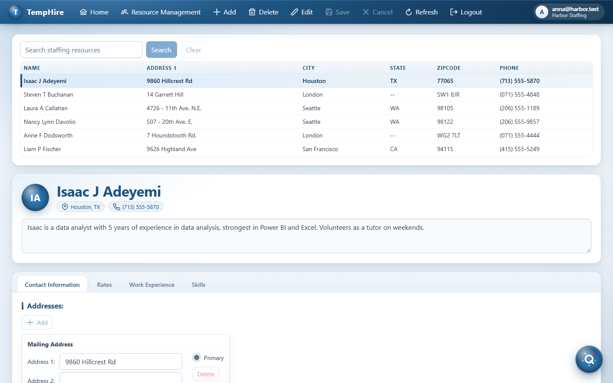
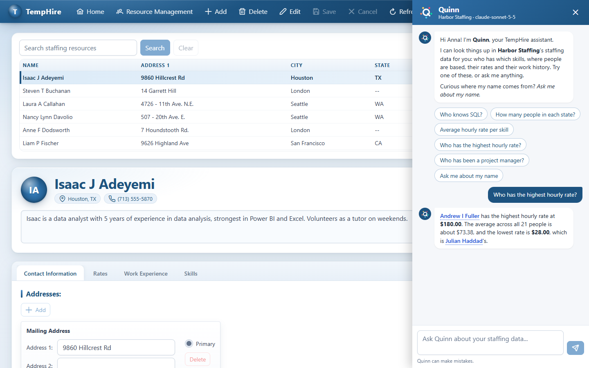
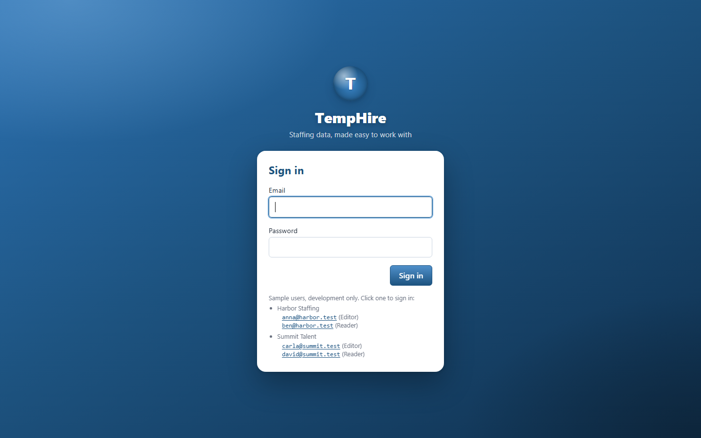

# Modernizing TempHire: from Silverlight to an AI-ready web app

TempHire is a line-of-business application of a kind that runs much of the world's business: a
staffing company's people, with their addresses, phone numbers, rates, skills and work history,
searched in a grid and edited in a form, with validation, save and cancel.  It was written for
Silverlight and WPF, on a framework that no longer has a future.

This document tells how it became a modern web application, and then a better application than it
ever was.  It is meant as a worked example of what can be done with a legacy application of your
own.  The work went in two steps:

1. **Convert** it to a modern stack, faithfully: same screens, same behaviour, same data model,
   on technology with a future.
2. **Modernize** it on that new foundation: an AI assistant, multi-tenancy, a fresh UI, and
   security to today's standards.

Both steps were done with AI: Claude Code wrote the code, a developer decided what to build and
reviewed every change.  The fourteen pull requests, from the conversion to OAuth, were merged
within five days.

The [README](../README.md) describes the application as it is now, and
[CONVERSION-NOTES.md](CONVERSION-NOTES.md) maps the original's architecture onto the new one, file
by file.  This document is the story in between.

---

## Where it started

TempHire began as the sample application of IdeaBlade's **Punch** framework (first called
Cocktail), in a [Silverlight and a WPF version](https://github.com/IdeaBlade/Punch/tree/master/Samples/TempHire).
Punch combined three things:

- **DevForce**, IdeaBlade's data access framework: a client-side `EntityManager` that caches
  entities and tracks their changes, LINQ queries composed on the client and run on the server, and
  one round trip to save a whole set of changes;
- **Caliburn.Micro**, for MVVM: view models, screens, a shell with workspaces;
- **Entity Framework 6**, Code First, over SQL Server Compact files.

Users lived in a table of the application's own, with passwords encrypted - reversibly - using a
key derived from the password itself.  Signing in kept a session on the DevForce EntityServer.

It was a good architecture for its day, and much of it holds up.  But Silverlight is gone, WPF
ties the application to Windows desktops, and DevForce belongs to the .NET Framework era.

---

## Step 1: Convert to a modern stack

**Pull request [#77](https://github.com/Breeze/temphire.angular/pull/77).**  The WPF original was
rewritten as a web application on:

| | Original | Converted |
|---|---|---|
| Client | WPF + Caliburn.Micro | **Angular 22**: standalone components, zoneless, signals, Signal Forms |
| Data access | DevForce `EntityManager` | **Breeze 3** (`breeze-client` 3 with generated entity classes) |
| Server | DevForce EntityServer (WCF) | **ASP.NET Core 10** + **Breeze .NET 8** |
| ORM | Entity Framework 6 | **EF Core 10** |
| Database | SQL Server Compact | **SQL Server** (LocalDB in development) |

### Choosing a target whose ideas match

The most important decision was the target.  **Breeze** is DevForce's idea in the web era: an
entity manager on the client that caches entities and tracks their changes, queries composed on
the client and run on the server, a change set saved in one round trip, and metadata shared by both
tiers.  So the conversion was mostly a *translation*, not a redesign.  The application's
"sandbox" editing - each edited person in its own unit of work, saved or cancelled as one - came
across almost literally, and so did the cached lookup data and the save interceptor's rules.

Where the two differ, the conversion notes say so and say why: the domain model can no longer be
one assembly shared by client and server (the client is TypeScript now), there is no lazy loading
(the detail screen loads what it needs in one query), and queries travel as JSON rather than
expression trees.

### Converting faithfully, then modernizing the code

The conversion kept the behaviour and made the code idiomatic for its new home:

- **Every ported file names the file it came from**, so the original and the conversion can be
  read side by side, and `CONVERSION-NOTES.md` maps every piece of the old architecture onto its
  replacement, with each deliberate change in behaviour.
- **The client is current Angular**, written the way Angular is written today: standalone
  components, zoneless change detection, signals, and Signal Forms.
- **One model, two tiers.**  The client's entity classes are *generated* from the server's model
  (Breeze 3's entity generator), and the validation rules written once on the server's entities
  (`[Required]`, `[StringLength]`) reach the client's forms through the Breeze metadata.  The
  original shared one compiled assembly; the web version shares the model's shape and rules
  instead.

### Evidence, not assertion

The pull request recorded what had been checked:

- **No known vulnerabilities**: `npm audit` and `dotnet list package --vulnerable` report none.
- Production builds of client and server **with no warnings**, and no deprecated APIs in use.
- **Regression tests** for the bugs found along the way.
- Every screen and every edit path exercised by hand in a browser.

The converted application did what the original did, on a stack with years of support ahead.
That alone is a successful modernization project.  It was also the starting point for the rest.

---

## Step 2: Take it to the next level

A converted application on a modern stack can do things the original never could.  Each of the
following came as its own pull request, on top of the last.

### Multi-tenancy

**[#78](https://github.com/Breeze/temphire.angular/pull/78).**  The original served one company.
TempHire now serves many, each seeing only its own people.  A user's company follows from their
email domain, and travels in their token.  An EF Core **global query filter** on every
company-owned entity confines every query - the grid, the detail screen, the search, the AI
assistant's tools - without any of them mentioning the company, and every save is checked so that
no change can touch another company's rows.  The client never sees a company id at all.

This is the kind of change that is hard on a legacy stack and natural on a modern one: one
mechanism in the data layer, and the whole application follows.

### An AI assistant: Quinn

**[#78](https://github.com/Breeze/temphire.angular/pull/78), then
[#80](https://github.com/Breeze/temphire.angular/pull/80),
[#81](https://github.com/Breeze/temphire.angular/pull/81),
[#84](https://github.com/Breeze/temphire.angular/pull/84)-[#86](https://github.com/Breeze/temphire.angular/pull/86).**
Quinn is a chat pane that answers questions about the company's staffing data in plain language:
*Who knows SQL? How many people do we have in each state? Who has worked as a project manager?*
The people it mentions are links that open their records.

How it is built matters more than what it does, because the same pattern fits any line-of-business
application:

- **The data is exposed as an MCP server**, inside the existing .NET server.  The
  [Model Context Protocol](https://modelcontextprotocol.io) is the open standard for giving AI
  models tools; TempHire's tools are read-only queries - search people, get one person, rate
  statistics, counts by location - written in **EF Core LINQ, not SQL**, through the same
  `DbContext` as the rest of the application.  So the tenant filter and the user's role apply to
  the AI exactly as to the screens.
- **The agent calls those tools as the user**, with the user's own access token.  Nothing the
  model asks for can reach another company's data or more than the user may see.
- **The model is a setting**: a small local model through Ollama, running on a laptop with 4 GB of
  video memory, or Claude through the Anthropic API.  The README compares the two honestly: the
  small model is good enough to demonstrate, Claude is good enough to rely on.
- **Answers stream** as the model writes them, and **links are made by the client from the people
  the tools returned**, never from text the model writes - so a link always opens the right record,
  and a name the model gets wrong is left as plain text.

Because the tools are a standard MCP server, they aren't only for Quinn: any MCP client - Claude
Code, say, or an agent of your own - can use them, with the same rules (see the security section
below).

### A fresh UI

**[#79](https://github.com/Breeze/temphire.angular/pull/79),
[#82](https://github.com/Breeze/temphire.angular/pull/82).**  The conversion used PrimeNG, the
closest match to the WPF controls: grids, tabs, dialogs, inline editors.  Then PrimeNG 22 went
closed source and started showing a license notice in any app without a key.  TempHire switched to
**[Optimus UI](https://optimus.openng.org/)**, the MIT-licensed community fork of PrimeNG 21: the
same components and templates, a change of imports.  A dependency's license is part of the
modernization too.

The look was then redone: one deep blue taken from the original's headings, cards with layered
shadows and a top highlight, glossy round avatars, a gradient toolbar, and a redesigned contact
information tab.  The screens are the same as the original's; they just look like 2026.

### Security to today's standards

**[#89](https://github.com/Breeze/temphire.angular/pull/89),
[#90](https://github.com/Breeze/temphire.angular/pull/90).**  This went in three steps, each a
foundation for the next.

**From a user table to ASP.NET Core Identity.**  The conversion had kept the original's own user
table, with better password hashing.  The users now live in **ASP.NET Core Identity**: salted,
iterated hashes, lockout after repeated failures, and a store that already knows about external
logins.

**Roles.**  Two roles, **Editor** and **Reader**, enforced by the server on every query and save,
and followed by the client, which offers a reader no Add, Edit or Delete.  Quinn follows them too:
a user without a role can chat with it, but its tools answer "access denied", and it says so
rather than guessing.

**OAuth 2.1.**  Finally the application's own token handling gave way to the industry standard.
TempHire's server is now its own **OAuth 2.1 authorization server**, built with
[OpenIddict](https://documentation.openiddict.com/):

- The Angular app signs in with the **Authorization Code flow and PKCE**, on the server's sign-in
  page.  The app never sees a password; it gets short-lived access tokens and refresh tokens.
- Tokens are **issued for named resources**: the API and the MCP endpoint each accept only tokens
  meant for them.
- The MCP endpoint implements the **MCP authorization specification**.  An MCP client such as
  Claude Code needs nothing but the URL: it discovers the authorization server, registers itself,
  and opens the browser for the user to sign in and consent.  Its token works at the MCP endpoint
  only, with the user's company and role.

The last step closes the circle with the AI work: the application's data is available to the
user's own AI tools, safely, through open standards.  And with OAuth in place, signing in with
**Microsoft Entra ID** is a button on the sign-in page, not a redesign; the README describes how.

---

## How the work was done

The code was written by Claude Code, working in the repository with a developer who decided what
to build, made the calls that were theirs to make, and reviewed every change.  A few practices made
that work:

- **Small, self-contained pull requests**, each with its reasoning, its evidence and what was not
  verified.  The history reads as a story because it was written as one.
- **Decisions stay with people.**  Where the right answer depended on the business - how a user's
  company is decided, whether MCP clients may register themselves, which UI library is acceptable to
  license - the choice was put to the developer with a recommendation, and the code followed.
- **Check claims against sources.**  When a design depended on how a library behaves, the library's
  source was checked rather than assumed.  That is how a latent bug from the conversion surfaced:
  saving a person's own fields failed, because a validation step hung database rows on an entity
  that the save then tried to insert again
  ([#87](https://github.com/Breeze/temphire.angular/pull/87)).  The fix also closed a gap the old
  check had missed.
- **Verify in the running application.**  Every change was exercised in a browser, through the
  API, or, for the OAuth work, with a scripted MCP client that walked the whole flow from discovery
  to a tool call.  Unit tests guard the subtle parts: the token renewal, the guards, the links in
  Quinn's answers.
- **Write it down.**  The README and the conversion notes were updated with every change, so the
  documentation describes the application as it is, not as it was.

| Date | Pull request | What changed |
|---|---|---|
| Nov 12, 2026 | [#77](https://github.com/Breeze/temphire.angular/pull/77) | The conversion: Angular 22, Breeze 3, .NET 10 |
| Nov 12 | [#78](https://github.com/Breeze/temphire.angular/pull/78) | Quinn, the AI assistant, with an MCP server; multi-tenancy |
| Nov 13 | [#79](https://github.com/Breeze/temphire.angular/pull/79) | Optimus UI instead of PrimeNG; a redesigned contact tab |
| Nov 14 | [#80](https://github.com/Breeze/temphire.angular/pull/80)-[#86](https://github.com/Breeze/temphire.angular/pull/86) | Streaming answers, reliable links to people, a better prompt for small models; the new look |
| Nov 15 | [#87](https://github.com/Breeze/temphire.angular/pull/87), [#89](https://github.com/Breeze/temphire.angular/pull/89) | A save fix; ASP.NET Core Identity; Editor and Reader roles |
| Nov 16 | [#90](https://github.com/Breeze/temphire.angular/pull/90) | OAuth 2.1 for the app and the MCP server |

---

## What it shows

- **Convert first, then modernize.**  A faithful conversion is a project with a clear finish line:
  the new application does what the old one did.  Everything after it is an improvement on a
  working application, shippable one step at a time, rather than a rewrite that has to be right in
  every way before anyone can use it.
- **Choose a target whose ideas match your application's.**  DevForce to Breeze was a translation
  because the two share their core ideas.  The closer the match, the more of the original design
  survives, and the more of the original's behaviour can be checked against it.
- **A modern stack is what makes AI possible.**  Quinn needed a clean data layer to put tools on,
  a server-side filter so the AI could never see more than the user, and standard authentication
  so outside AI tools could connect.  None of that was available on the original stack; all of it
  came naturally after the conversion.
- **Security is part of modernization.**  The original's reversibly encrypted passwords would be
  unacceptable today.  Identity, roles and OAuth 2.1 bring the application to the standard any
  security review expects, and make enterprise sign-in a configuration step.
- **AI makes the whole journey fast.**  Once the conversion was in, the modernization - an AI
  assistant, multi-tenancy, a new UI library and look, Identity, roles and OAuth - took four days.
  That would not have been possible by hand.  The speed comes with discipline, not instead of it:
  small changes, evidence for each, and a person deciding what matters.

---

## Where it could go next

- **Sign in with Microsoft Entra ID**, with each company assigning roles in its own directory.
- **Client ID Metadata Documents**, the newest MCP specification's preferred way for MCP clients
  to identify themselves, once OpenIddict supports them.
- **Write tools for Quinn**, for editors, with a confirmation step before anything changes.
- **Administration**: managing users and roles, and the MCP clients users have authorized.
